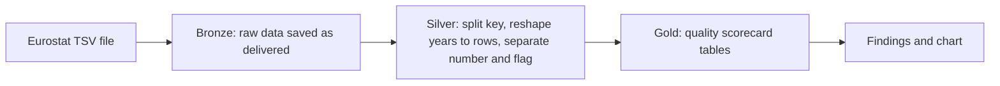

# Is this data trustworthy? A data-quality pipeline on Eurostat life-satisfaction data

A small end-to-end data pipeline (Bronze → Silver → Gold) built in Databricks that takes a raw Eurostat file, cleans it, and produces a **data-quality scorecard** showing how much of the data can be trusted.

## The problem

Before an organisation analyses data or feeds it into an AI system, someone has to answer a simple question: *can we trust this data?* In Europe this matters more each year. The EU AI Act includes data-governance duties for high-risk AI systems, and under the 2026 AI Omnibus agreement the date for stand-alone high-risk systems moved to 2 December 2027 (check the final published text). Teams that can measure and document data quality now are better prepared.

This project shows the first step: turning a messy public file into clean data **plus** a measurable quality report.

## The data

Eurostat table **ilc_pw01**, *Overall life satisfaction by sex, age and educational attainment* (downloaded 28 October 2026 as a TSV file).
Raw size: 6,240 rows × 7 year columns (2013, 2018, 2021–2025) = 43,680 values once reshaped.

### Problems found in the raw file

| Problem | How it appears |
|---|---|
| Eight facts jammed into one column | `A,AVG,RTG,ED0-2,LIFE,F,Y16-19,AL` |
| Years stored as columns | one column per year |
| Missing values written as text | `:` and also `: u`, `: m` |
| Quality letters attached to numbers | `8.0 u` |

A first version of my cleaning rules only recognised a plain `:` as missing. My own safety check found **2,232 values** (`: u` = 1,734 and `: m` = 498) that were neither readable numbers nor marked missing. I investigated them and fixed the rule. This is why the pipeline keeps an explicit "unreadable but not missing" check.

## Pipeline

- **Bronze** (`bronze_life_satisfaction`): the raw values saved as plain text. Only column labels were renamed (Delta tables reject commas and backslashes in names).
- **Silver** (`silver_life_satisfaction`): 8 separate descriptive columns, one row per series and year, numeric `value`, quality `flag`, and boolean checks `is_missing` and `is_out_of_range`.
- **Gold**: four tables: `gold_quality_scorecard`, `gold_column_health`, `gold_quality_by_country`, `gold_quality_by_year`.

## Results

| Check | Count | Share |
|---|---|---|
| Missing values | 6,756 of 43,680 | 15.47% |
| Values carrying any quality flag | 11,757 | 26.92% |
| Low-reliability values (flag `u`) | 9,387 | 21.49% |
| Out of range (outside the 0–10 scale) | 0 | 0% |
| Duplicate series in the raw file | 0 of 6,240 | 0% |

Only the `value` column has missing data. The eight descriptive columns are complete.

### Findings

- **Missing data is concentrated, not spread evenly.** Kosovo (XK, 86.5%), EA21 (86.2%), Iceland (74.1%), and the United Kingdom (72.5%) have by far the most gaps. Possible reasons, not yet verified, include newly defined aggregates and countries that stopped reporting. Check Eurostat's metadata before stating a cause.
- **Missing and unreliable are different problems.** Portugal has only 17% missing values, but 84.7% of its values carry the low-reliability flag.
- **Year matters.** 2021 has the most missing values (22.9%), 2018 the fewest (9.1%). 2013 has the highest share of low-reliability values (40.9%).
- **The `geo` column mixes countries and aggregates** (for example EA20, EA21, EU27_2020). Averages across it need care.

### Quality flags found in this file

Meanings follow Eurostat's official flag list (https://ec.europa.eu/eurostat/web/main/data/database). Two-letter codes combine two flags.

| Flag | Meaning | Count |
|---|---|---|
| `u` | low reliability | 9,156 |
| `b` | break in time series | 984 |
| `e` | estimated | 627 |
| `m` | missing value, data cannot exist | 498 |
| `p` | provisional | 261 |
| `bu` | break in time series + low reliability | 208 |
| `pu` | provisional + low reliability | 23 |
| (none) | no flag | 31,923 |

Flags can sit on a number (`8.0 u`) or on a missing value (`: u`, `: m`).

### Chart

*(Add a screenshot of the missing-percentage-by-year bar chart here.)*

## What I would improve

1. Add a column that tags each `geo` code as a country or an aggregate, so quality can be compared fairly.
2. Split "missing" into two kinds: values that are simply not available, and values Eurostat flags `m` ("missing value, data cannot exist"). The 498 `m` values are not a quality failure, because the value cannot exist. Counting them separately would lower the missing share from 15.47% to 14.33%.
3. Schedule the notebook to re-run automatically and alert when the missing share rises, so quality is monitored instead of checked once.

## Tools

Databricks Free Edition (serverless), PySpark, Delta tables, Unity Catalog volumes, GitHub.

## How to reproduce

1. Download Eurostat table `ilc_pw01` as TSV and upload it to a Unity Catalog volume named `raw_eurostat`.
2. Import the notebook and press **Run all**.
3. Open the four `gold_*` tables in the Catalog.

## Author

Your name · [LinkedIn link]
